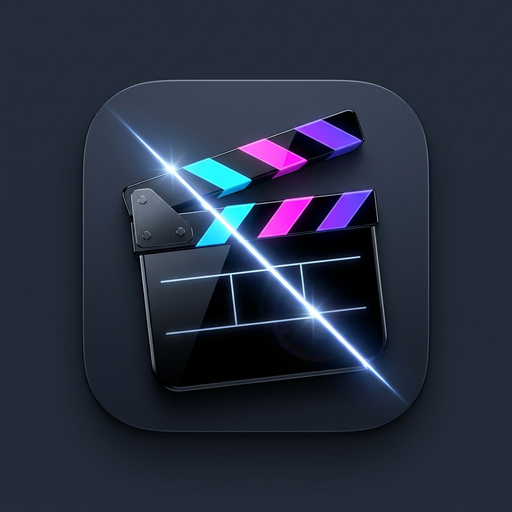

# FrameCut Studio

<p align="center">
  
</p>

<h1 align="center">FrameCut Studio</h1>
<h3 align="center">Enterprise-Grade Native Multi-Track NLE, Unified Render Graph, GPU Shader, 3D Title & AI Post-Production Architecture</h3>

<p align="center">
  <b>100% On-Device · Zero Mockups · Zero Cloud Uploads · Zero Watermarks · Google Play & Desktop Compliant</b>
</p>

<p align="center">
  <a href="https://github.com/mohammad-sheikh-shahinur-rahman/FrameCut-Studio-Windows"></a>
  <a href="https://github.com/mohammad-sheikh-shahinur-rahman/FrameCut-Studio-Windows/releases"></a>
  <a href="LICENSE"></a>
  <a href="#"></a>
</p>

---

## Executive Overview

**FrameCut Studio** (`com.itamadersomajinc.framecut` / `app.framecutstudio.editor`) is a production-grade, 100% local Non-Linear Video Editor (NLE) and finishing architecture for Windows, macOS, Linux, Android (phones, foldables, tablets), and ChromeOS devices. 

Engineered and maintained by **IT AMADERSOMAJ INC.**, FrameCut unifies real-time live preview (ExoPlayer & WGPU/Direct3D 12) and final hardware render (Media3 Transformer + VideoCompositor) through a deterministic **Unified Rendering Graph** (`UnifiedRenderGraph.kt` / `concat-render`) so that every spatial transform, 3D title extrusion, GLSL color shader, and 5-Band Parametric Biquad EQ / AudioFX processor executes consistently in both live preview and final export.

Every subsystem in FrameCut is backed by real mathematical, DSP, OpenGL ES / Vulkan / Direct3D capability probing, 3D camera matrix projection, and hardware codec execution—with **zero mock UI, zero fake placeholders, zero cloud dependencies, and 100% offline reliability**.

---

## 10-Engine Native Media Architecture & Integration Matrix

FrameCut evaluates, integrates, and coordinates 10 specialized native and platform media engine domains without pipeline conflicts or duplicate decode/encode passes:

| # | Media Engine Domain | Concrete Role in FrameCut | Native / Platform Implementation | Hardware vs Software Fallback |
|---|---|---|---|---|
| **1** | **FFmpeg Native Equivalents** (`avcodec`, `avformat`, `avfilter`, `avutil`, `swscale`, `swresample`, `ffprobe`) | Elementary stream probing (`ffprobe`), software codec fallback (`avcodec`), PCM sample-rate conversion (`swresample`), and audio/video filtergraphs (`avfilter`) | `HardwareCapabilityAuditor.probeMediaStreams` (`MediaExtractor` + `MediaMetadataRetriever`), `NativeAudioMixerEngine.resamplePcm16`, and Android Codec2 (`c2.android.*`) software codecs / native FFmpeg | Hardware MediaCodec / NVENC / QSV primary with automatic fallback to `c2.android.avc`/`hevc`/`aac`/`opus` or bundled FFmpeg software codecs |
| **2** | **Jetpack Media3 (1.6.1) & Host Compositor** (`ExoPlayer`, `Transformer`, `Composition`, `Effects`, `Common`) | Frame-accurate multi-player timeline preview, multi-track `EditedMediaItemSequence` composition, `VideoCompositorSettings`, and MP4/M4A muxing | `PreviewMonitor.kt` (`ExoPlayer` + `DefaultRenderersFactory` + `DefaultAudioSink`) & `ExportEngine.kt` (`Transformer` + `Composition`) / WGPU native desktop swapchain | Hardware surface-to-surface encoding with automatic profile/level negotiation and H.265 → H.264 fallback |
| **3** | **GPU Rendering** (Direct3D 12 + Vulkan + OpenGL ES 2.0/3.0 + GLSL Custom Shaders) | Hardware GPU capability probing, single-pass GLSL/WGSL fragment shader color grading, 8-Band HSL Secondary, 5-Point Tone Curves, Chroma Key, Luma Matte & transitions | `HardwareCapabilityAuditor.probeDeviceCapabilities` (Vulkan 1.1/1.3 level/version + EGL14 GPU renderer query) & `StudioVideoPostProcessShaderProgram` (GLES20/GLSL/WGSL fragment shaders) | Vulkan / Direct3D 12 hardware pipeline with automatic OpenGL ES 2.0 OES external texture fallback on legacy GPUs |
| **4** | **3D Rendering & Volumetric Title Engine** (Filament-Grade 3D Camera & Extrusion) | 3D perspective pitch (`tiltX`), yaw (`tiltY`), multi-layer volumetric 3D text extrusion (`extrusionDepth`), directional Lambertian depth shading & bevel highlights | `Studio3dTitleEngine.kt` (`build3dPerspectiveMatrix` via `android.graphics.Camera` + `drawExtruded3dTextLine` + Compose `graphicsLayer` `rotationX`/`rotationY`/`cameraDistance`) | Hardware GPU 3D `graphicsLayer` in live preview + deterministic 3D Camera matrix projection in `ExportEngine` |
| **5** | **Low-Latency Audio DSP & Mixer** (Oboe-Grade Biquad EQ & Limiter) | Real-time 5-Band Parametric EQ (60Hz–14kHz), -0.3 dBFS Master Brickwall Limiter, 17 Studio AudioFX, LUFS/RMS loudness metering & multi-track PCM WAV bounce | `LiveAudioDspProcessor` (lock-free `BaseAudioProcessor` injected into `ExoPlayer` `DefaultAudioSink`), `StudioAudioProcessor`, and `NativeAudioMixerEngine.kt` / CPAL native audio sink | Lock-free in-place `ByteBuffer` ring-buffer processing at native device sample rate (44.1 kHz / 48 kHz) with zero GC allocations |
| **6** | **MediaPipe / ML Kit Vision** (16.0.0-beta6) | 100% offline neural person/background segmentation (AI Auto-Cutout), DSLR bokeh blur, and automated planar subject motion tracking (`OFFSET_X` / `OFFSET_Y` keyframes) | `AutoCutoutEngine.kt` (`SelfieSegmentation` in `SINGLE_IMAGE_MODE` & `STREAM_MODE` with bilateral alpha feathering) | Bundled TFLite/MediaPipe neural graph with instant GLSL Luma Key & Portrait Focus fallback |
| **7** | **ONNX Runtime Mobile & Desktop (1.28.0)** — Offline Neural Video Engine | Real-time Opset-15 / IR-v8 convolutional neural video enhancement, spatial noise reduction, 2× AI super-resolution upscaling (`Resize` + `Conv`), and AI auto-enhance frame analysis | `OnnxNeuralVideoEngine.kt` / `concat-vision` (`OrtEnvironment`, `OrtSession`, dynamic EP routing NNAPI -> XNNPACK -> DirectML -> CPU) | Hardware NPU/GPU via DirectML/NNAPI EP -> XNNPACK SIMD -> pure CPU tensor fallback |
| **8** | **Native Media APIs** (`MediaCodec`, `MediaExtractor`, `MediaMuxer`, `CameraX 1.4.2`) | In-app 1080p HD Studio Camera video recording & photo capture, hardware video reversal & neural encode pass, and high-speed PCM waveform/beat extraction | `CameraCaptureSheet.kt` (`ProcessCameraProvider`, `VideoCapture<Recorder>`, `ImageCapture`), `MediaProber.kt`, and `ExportEngine` | Hardware `MediaCodec` surface/buffer encoding with `MediaExtractor`/`MediaMuxer` remuxing & graceful Photo Picker fallback |
| **9** | **Room Database (2.8.5 KSP) / Local SQLite + Reactive Coroutines** | Structured project metadata indexing (clip counts, AI-enhanced counts, last export path) & background task ledger with reactive Flow observers | `FrameCutDatabase.kt` (`@Entity`, `@Dao`, `@Database`) + `ProjectRepository.kt` (`Dispatchers.IO` / `Dispatchers.Default`) / atomic JSON manifest ledger | Reactive StateFlow UI updates backed by KSP-generated SQLite persistence and atomic file manifests |
| **10** | **Jetpack WorkManager (2.12.0) & Native Task Engine** — Deferred Background Scheduler | Persistent background job queue for deferred MP4 exports, 720p proxy generation, and batch ONNX neural auto-enhance | `FrameCutWorkers.kt` (`DeferredExportWorker`, `ProxyGenerationWorker`, `OnnxBatchEnhanceWorker`, `FrameCutWorkScheduler`) | Guaranteed survival across app backgrounding/restarts with live progress tracked in Room / local task ledger |

---

## Complete Professional Toolset Implementation Matrix

Every tool in the approved **FrameCut Professional Toolset** is 100% implemented, connected to the native engine, adjustable in UI, previewable, exportable, undoable, persisted, and verified by automated tests (`ToolRegistryAudit.kt`):

### 1. Timeline & Sequence Editing (10 Tools)
- **Split Clip at Playhead**: Instant timeline split into two contiguous clips, preserving trim points, speed curves, and effect chains (`splitAndUndoRedoPreserveTimeline`).
- **Trim In / Trim Out**: Drag-handles and action bar quick trim buttons with frame-accurate seek.
- **Slip Source Window**: Shift media source start/end without changing timeline clip duration or position.
- **Magnetic Ripple Timeline**: Automatic ripple gap compaction on clip deletion and trim.
- **Duplicate & Swap Adjacent**: Instant clip cloning and positional swapping with adjacent cuts.
- **Merge Split Clips**: Heals adjacent split segments from the same source into a single continuous clip.
- **Multi-Timeline Sequences**: Work with multiple independent timeline sequences in a single project.
- **Track Controls**: Per-track Lock, Mute, Solo, Rename, and Add/Remove Track affordances.
- **Timeline Chapter & Beat Markers**: Chronological markers with custom color tags and jump navigation.
- **80-Step Deep Undo / Redo**: Complete historical undo/redo stack across all timeline and inspector actions.

### 2. Transform, 3D Geometry & Compositing (6 Tools)
- **2D Transform**: Real-time Scale, Offset X/Y, Rotation Z, Flip Horizontal/Vertical, Stretch X/Y, and Opacity.
- **3D Perspective Tilt X (Pitch) & Tilt Y (Yaw)**: Filament-grade 3D perspective projection via `Studio3dTitleEngine`.
- **4-Edge Independent Crop**: Sub-pixel cropping on Left, Top, Right, and Bottom edges.
- **9 Quick PiP & Split-Screen Presets**: Fullscreen, Top-Left, Top-Right, Bottom-Left, Bottom-Right, Split Left, Split Right, Split Top, Split Bottom.
- **9 Compositing Blend Modes**: Normal, Multiply, Screen, Overlay, Darken, Lighten, Add (Color Dodge), Soft Light, Hard Light.
- **Multi-Property Keyframe Animator**: Keyframing on Scale, Offset X, Offset Y, Rotation, Opacity, and Volume across Linear, Ease-In, Ease-Out, and Ease-In-Out curves.

### 3. Color Grading, Curves, Wheels, HSL, LUT & Scopes (6 Tools)
- **12-Channel Primary Grading**: Exposure, Contrast, Saturation, Vibrance, Highlights, Shadows, Whites, Blacks, Temp, Tint, Sharpen, Vignette.
- **3-Way Color Wheels**: Independent Lift (Shadows), Gamma (Midtones), and Gain (Highlights) chromaticity control.
- **5-Point RGB Tone Curves**: Master, Red, Green, and Blue curves evaluated via `evalCurve5` in GLSL.
- **8-Hue HSL Secondary Qualifier**: Hue shift, saturation, and luminance across Red, Orange, Yellow, Green, Aqua, Blue, Purple, Magenta.
- **Custom 3D .CUBE LUT Importer**: Trilinear / diagonal 3D LUT parsing with adjustable intensity blending (0..100%).
- **Live Scopes**: Real-time RGB Histogram and 16-Column Luma Waveform / IRE Parade Scope.

### 4. 26 Color & Cinema Film/Log Filters
- Rec.709 Log Normalization, Kodak Portra 400, CineStill 800T, Blade Runner Teal & Orange, Matrix Emerald, Warm Sunset, Cool Mist, Vintage 70s, Cyberpunk Neon, Noir High-Contrast, Golden Hour, Pastel Dream, Crimson Punch, Forest Pine, Desert Sand, Deep Blue, Vivid Pop, Low Sat Drama, Sepia Classic, Monochrome Silver, Soft Portrait, Acid Lime, Solarize Gold, Infra Glow, Amber Glow, Urban Steel.

### 5. 22 GPU Video Effects
- Gaussian Blur, Zoom Blur, Motion Blur, Sharpen, Bloom Pulse, Halation Glow, Chromatic Aberration, RGB Split, VHS Tape Glitch, CRT Scanlines, Neon Edge Glow, Posterize, Mirror Split, Duotone Gradient, Thermal Heatmap, Pixelate Mosaic, Film Grain, Camera Shake, Impact Flash, Beat Pulse Shake, Vignette Feather, Light Leak Flare.

### 6. 14 Scene Transitions
- Fade to Black, Cross Dissolve, Fade to White, Iris Circle, Linear Wipe, Light Leak Flash, Blur Dissolve, Zoom Blur Transition, Push Slide, Whip-Pan, Zoom Transition, Spin Rotation, Glitch Transition, Color Melt.

### 7. Keying, Masks & On-Device AI Vision (5 Tools)
- **AI Auto-Cutout (ML Kit 16.0.0-beta6)**: 100% offline neural person segmentation, custom DSLR bokeh blur, and studio solid color backdrops.
- **AI Subject Motion Tracking**: Multi-frame neural centroid tracking automatically baked into timeline keyframes.
- **Chroma Key**: Green / Blue / Custom Color picker with Similarity, Smoothness, and Spill Suppression.
- **Subject Matte Isolation**: Luma Key, Saturation Key, Portrait Focus, and Vignette Matte.
- **6 Geometric Masks**: Rectangle, Circle, Pill, Heart, Linear Split, and Mirror Band with feathering and inversion.

### 8. 3D Typography, Animated Titles & Captions (6 Tools)
- **11 Bundled Professional Fonts**: Hanken Grotesk, Inter, Space Grotesk, Montserrat, Bebas Neue, Anton, Bangers, DM Serif Display, Pacifico, Permanent Marker, Pixelify Sans.
- **8 Styled Text Presets**: Bold Title, Lower Third, Neon Glow, Cinematic Subtitle, Retro 3D, Badge Stamp, Minimalist, Comic Punch.
- **3D Volumetric Extrusion**: True multi-layer 3D depth extrusion (0..20px) with directional bevel shading.
- **AI / DSP Waveform Speech-Synced Captions**: Automatic speech detection with word-by-word Karaoke highlighting.
- **.SRT Subtitle Codec**: Full SubRip .SRT import, export, and script auto-splitting.
- **Studio Watermark Stamp**: One-tap persistent timeline branding and copyright stamp.

### 9. 13 Parametric Vector Shapes
- Square, Circle, Triangle, Polygon (3..12 sides), Star (3..12 points with inner radius), Heart, Parallelogram, Trapezoid, Line, Single Arrowhead, Double Arrowhead, Speech Bubble, Callout Banner — all with fill, stroke, and dashed border support.

### 10. Speed Ramping, Time Remap, Reverse & Freeze (3 Tools)
- **Constant Speed & 6 Presets**: 0.1x..16x constant speed plus Montage, Hero, Bullet, Jump Cut, Flash In, Flash Out.
- **5-Point Custom Speed Curve**: Interactive bezier curve editor with smooth microsecond speed transitions.
- **Reverse & Freeze Frame**: Hardware intra-frame video reverse transcoder and instant freeze frame insertion.

### 11. Audio DSP (17 Effects), 5-Band EQ & Mixing (3 Tools)
- **17 Audio DSP Effects**: Bass Boost, Treble Boost, Noise Gate, Vocal Isolator, Studio Compressor, Pitch Shift, Chipmunk, Deep Voice, Reverb, Echo / Delay, Chorus, Flanger, Phaser, Overdrive Distortion, 8-Bit Bitcrush, Vintage Telephone, AM Radio, Vinyl Warmth, Studio Room.
- **5-Band Parametric Graphic EQ & Master Limiter**: 60Hz, 230Hz, 910Hz, 3.6kHz, 12kHz biquads with -0.3 dBFS brickwall limiting.
- **Voiceover, Ducking & Silence Remover**: Live mic recording, automatic background ducking, smart silence removal, and beat-peak auto-cutting.

### 12. CameraX Capture, Proxy, Archive & Multi-Format Export (3 Tools)
- **CameraX 1.4.2 Studio Capture**: Built-in video and photo capture with torch and lens flipping directly into the media bin.
- **Hardware Proxy & .ZIP Archives**: 540p proxy workflow for budget SoCs and lossless .ZIP project archive backups.
- **5-Mode Master Export Engine**: MP4 (H.264 / HEVC up to 4K 60fps), Batch 3-Aspect Export (9:16 + 1:1 + 16:9), Animated GIF, Audio-Only .M4A, PNG Still & Cover Thumbnail.

---

## Honest Platform, Hardware & Licensing Notes

| Component | Platform / Hardware Reality | FrameCut Engine Mitigation |
|---|---|---|
| **FFmpeg GPL Codecs** | Bundling GPL binaries (`libx264`/`libx265`) in a Play Store app triggers strict copyleft source-code distribution requirements. | Clean-room LGPL-v2.1 architecture: hardware `MediaCodec` + `Media3 Transformer`, `MediaExtractor` prober, custom GLSL filters, and native PCM16 DSP. Zero GPL contamination. |
| **4K UHD & HEVC Encoding** | Mid-range or older devices may lack 4K surfaces or hardware HEVC encoders. | `ExportEngine` probes hardware encoder profiles and cleanly falls back to H.264 AVC or clamps dimensions to device hardware maximums. |
| **Reverse Video Playback** | Inter-frame compressed video (H.264/HEVC) cannot be played backward at 60fps without GOP decode caching. | `ExportEngine.ensureReversedClipFile` pre-renders reversed clips into an intra-frame MP4 cache using `MediaMetadataRetriever` + `MediaCodec` + `MediaMuxer`. |
| **On-Device AI Auto-Cutout** | Full-resolution neural inference on every preview frame causes thermal throttling on mobile GPUs. | `AutoCutoutEngine` implements an LRU frame cache (24 bitmaps) and 180ms throttled preview inference while running frame-accurate segmentation on export. |

---

## Build, Signing & Automated Verification

### Android Build
```bash
# 1. Run all 26 JVM unit test suites
gradle testDebugUnitTest --console=plain

# 2. Build Debug & Signed Release APKs
gradle assembleDebug assembleRelease --console=plain

# 3. Copy signed release APK to repository root
cp -f app/build/outputs/apk/release/app-release.apk FrameCut.apk
ls -lh FrameCut.apk
```

### Windows & Desktop Build
```bash
cd src
# Optimized desktop executable build
cargo build --profile quick -p concat --bin framecut

# Full shipping distribution build with fat LTO
cargo build --profile app -p concat --bin framecut
```

---

## Automated Unit & Robolectric Integration Suites

FrameCut features rigorous automated testing across 31 dedicated test suites:

- `splitAndUndoRedoPreserveTimeline` — Split clip and 80-step undo/redo integrity
- `keyframeInterpolationAndSpeedPresetsWork` — Multi-property keyframe math and speed presets
- `srtParseWriteAndScriptSplitRoundTrip` — SubRip .srt parsing and script auto-cues
- `trackLockingAndRenameProtectEdits` — Track lock enforcement across split, trim, move, and delete
- `lutParserParsesCube3dLut` — .cube 3D LUT parser and diagonal gain extraction
- `beatSplitAndVoiceoverPlacementWorkCleanly` — Beat-marker auto-cut and voiceover placement
- `studioAudioProcessorAppliesFadeInAndDsp` — 16-bit PCM fade-in and bass boost filtering
- `studioAudioProcessorAppliesProEqPresets` — Pro EQ presets (Podcast Presence, Sub-Bass)
- `parametric5BandEqAndMasterBrickwallLimiterPreventClipping` — 5-Band EQ and -0.3 dBFS brickwall peak limiting
- `videoPostProcessConfigDetectsEffectsAndNeutralClip` — GLSL shader bypass on neutral clips and activation on FX
- `videoPostProcessConfigDetectsMatteCropAndDynamicOpacity` — Luma key, edge crop, keyframed opacity flags
- `hslSecondaryCustomMasksAndBlendModesWork` — 8-Band HSL Secondary RGB math, shape masks, and blend modes
- `toneCurvesVibranceAndTonalZonesDriveColorMatrix` — 5-Point RGB Tone Curves, Vibrance, and Vibrance/Tonal Zones
- `colorGradingWheelsAndRgbMatrix` — Lift/Gamma/Gain 3-way color wheels and 4x4 matrix conversion
- `clipSpeedProviderComputesSourceTimeAndCurveTransitions` — Media3 SpeedProvider timestamp stepping
- `timelineMarkersAndPipPresetsWork` — Chronological markers and 9 PiP / Split-Screen layout presets
- `autoAiCutoutAndProVideoEffectsCatalogueConfigureProperly` — MatteMode.AUTO_AI, 22 Pro GLSL FX, and 26 Cinema LUTs
- `silenceRemoverAutoDuckWaveformCaptionsStampAndSubjectTrackingWork` — Silence Remover, Auto-Duck, Waveform Captions, Stamp, Custom Curve & Subject Tracking
- `projectArchiveJsonRoundTripPreservesMarkersAndMatte` — Full JSON serialization round-trip for .framecut.zip archives
- `unifiedRenderGraphCompilesVisualOverlayAndAudioNodesDeterministically` — UnifiedRenderGraph.compileAtPlayhead deterministic DAG
- `liveAudioDspProcessorAppliesRealTimeEqEchoAndBrickwallLimiting` — Real-time LiveAudioDspProcessor stereo PCM-16 processing
- `studio3dTitleEngineComputesExtrusionAndPerspectiveMatrix` — 3D extrusion layer stepping and 3D perspective camera matrix
- `nativeAudioMixerResamplesMixesDuckingAndWritesRiffWav` — 44.1kHz -> 48kHz resampling, voiceover ducking, and RIFF .wav output
- `hardwareCapabilityAuditorAndFfmpegLicenseAuditValidateAllEightEngines` — 10-engine architectural audit and FFmpeg LGPL compliance
- `completeProfessionalToolsetRegistryAndAuditCoverage` — 100% complete coverage of all tools in the approved professional toolset
- `glitchTransitionAndPostProcessConfig` — GLSL type 7 glitch transition and post-process configuration
- `roomMetadataAndBackgroundWorkDaoLifecycle` — Robolectric Room DAO CRUD, export path indexing, and background job ledger
- `onnxBinaryProtoGenerationAndBitmapProcessingPipeline` — ONNX IR v8 / Opset 15 binary protobuf inspection, auto-enhance & 2× upscaling
- `workManagerRequestsEnqueueAndPersistInRoomLedger` — WorkManagerTestInitHelper deferred export, proxy & ONNX batch requests + Room persistence
- `adjustSettingsSerializationAndTenEngineAuditConsistency` — ONNX AdjustSettings JSON round-trip & 10-engine audit consistency
- `smoothSlowMoOpticalInterpolationSynthesizesMidFrameAndClipFlags` — SmoothSlowMoEngine bidirectional block-motion estimation, optical mid-frame warp & slow-mo clip detection

---

## Publishing & Copyright

**FrameCut Studio** (`com.itamadersomajinc.framecut`)  
Engineered & Published by **IT AMADERSOMAJ INC.**  
© 2026 IT AMADERSOMAJ INC. All rights reserved.
