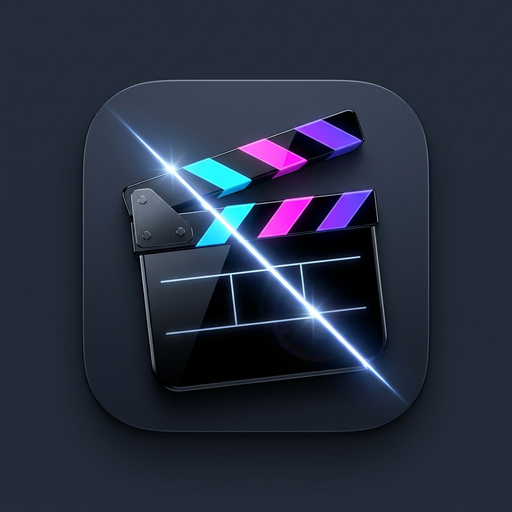

# FrameCut Studio

  

<h1 align="center">FrameCut Studio</h1>
<h3 align="center">এন্টারপ্রাইজ-গ্রেড নেটিভ মাল্টি-ট্র্যাক NLE, ইউনিফাইড রেন্ডার গ্রাফ, GPU শেডার, 3D টাইটেল এবং AI পোস্ট-প্রোডাকশন আর্কিটেকচার</h3>

  <b>১০০% অন-ডিভাইস · জিরো মক-আপ · জিরো ক্লাউড আপলোড · জিরো ওয়াটারমার্ক · গুগল প্লে ও উইন্ডোজ কমপ্লায়েন্ট</b>

  <b>ইঞ্জিনিয়ার্ড এবং পাবলিশড: IT AMADERSOMAJ INC.</b> 
  অ্যাপ্লিকেশন আইডি: <code>com.itamadersomajinc.framecut</code> / <code>app.framecutstudio.editor</code>

---

## সংক্ষিপ্ত বিবরণ

**FrameCut Studio** হলো একটি প্রোডাকশন-গ্রেড, ১০০% লোকাল নন-লিনিয়ার ভিডিও এডিটর (NLE)। এটি উইন্ডোজ, ম্যাকওএস, লিনাক্স, এবং অ্যান্ড্রয়েড (ফোন, ফোল্ডেবল, ট্যাবলেট) ডিভাইসের জন্য অত্যন্ত শক্তিশালী পোস্ট-প্রোডাকশন প্রযুক্তি প্রদান করে।

**IT AMADERSOMAJ INC.** দ্বারা প্রকৌশলীকৃত ও পরিচালিত এই সফটওয়্যারটি রিয়েল-টাইম প্রিভিউ এবং ফাইনাল হার্ডওয়্যার রেন্ডারকে একটি ডিটারমিনিস্টিক **ইউনিফাইড রেন্ডারিং গ্রাফ (Unified Rendering Graph)**-এর মাধ্যমে পরিচালনা করে। ফলে প্রিভিউ এবং চূড়ান্ত এক্সপোর্ট উভয় ক্ষেত্রেই একই স্পেশিয়াল ট্রান্সফর্ম, 3D টাইটেল এক্সট্রুশন, GLSL কালার শেডার এবং ৫-ব্যান্ড প্যারামেট্রিক EQ / অডিও প্রসেসর নিখুঁতভাবে কাজ করে।

---

## ১০-ইঞ্জিন নেটিভ মিডিয়া আর্কিটেকচার

1. **FFmpeg নেটিভ ইন্টিগ্রেশন**: স্ট্রিম প্রোবিং, সফটওয়্যার কোডেক ফলব্যাক, PCM স্যাম্পল-রেট কনভার্সন এবং অডিও/ভিডিও ফিল্টারগ্রাফ।
2. **অ্যান্ড্রয়েড মিডিয়া৩ / হোস্ট কম্পোজিটর**: ফ্রেম-অ্যাকিউরেট মাল্টি-প্লেয়ার প্রিভিউ এবং হার্ডওয়্যার সারফেস এক্সপোর্ট।
3. **GPU রেন্ডারিং (Direct3D 12 / Vulkan / OpenGL ES)**: ফুল হার্ডওয়্যার অ্যাক্সিলারেশন, সিঙ্গেল-পাস GLSL/WGSL ফ্র্যাগমেন্ট শেডার, ৮-ব্যান্ড HSL ও ৫-পয়েন্ট টোন কার্ভ।
4. **3D রেন্ডারিং এবং ভলিউমেট্রিক টাইটেল ইঞ্জিন**: 3D পারসপেক্টিভ টিল্ট, মাল্টি-লেয়ার 3D টেক্সট এক্সট্রুশন এবং শ্যাডো বেভেল হাইলাইটস।
5. **লো-লেটেন্সি অডিও DSP এবং মিক্সার**: ৫-ব্যান্ড প্যারামেট্রিক EQ, -0.3 dBFS ব্রিকওয়াল লিমিটিং এবং ১৭টি স্টুডিও অডিও এফেক্টস।
6. **মিডিয়াপাইপ / ML Kit ভিশন**: সম্পূর্ণ অফলাইন AI অটো-কাটআউট, ব্যাকগ্রাউন্ড রিমুভাল, বোকেহ ব্লার এবং মোশন ট্র্যাকিং।
7. **ONNX Runtime (1.28.0) নিউরাল ভিডিও ইঞ্জিন**: রিয়েল-টাইম কনভোলিউশনাল নিউরাল নয়েজ রিডাকশন এবং ২x সুপার-রেজোলিউশন আপস্কেলিং।
8. **নেটিভ মিডিয়া APIs**: ইন-অ্যাপ ক্যামেরা ক্যাপচার, হার্ডওয়্যার রিভার্সাল এবং পিসিএম ওয়েভফর্ম ডিটেকশন।
9. **লোকাল ডেটাবেস ও রিয়্যাক্টিভ ফ্লো**: মেটাডেটা ইন্ডেক্সিং এবং ব্যাকগ্রাউন্ড টাস্ক লেজার।
10. **ডিফার্ড ব্যাকগ্রাউন্ড শিডিউলার**: ব্যাকগ্রাউন্ডে এমপি৪ এক্সপোর্ট, ৭২০p প্রক্সি তৈরি এবং ব্যাচ নিউরাল অটো-এনহ্যান্স।

---

## পাবলিশিং ও কপিরাইট

**FrameCut Studio** (`com.itamadersomajinc.framecut`)  
Engineered & Published by **IT AMADERSOMAJ INC.**  
© 2026 IT AMADERSOMAJ INC. All rights reserved.
